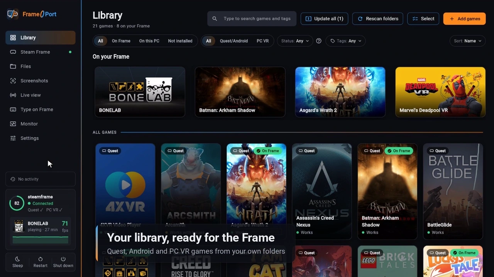
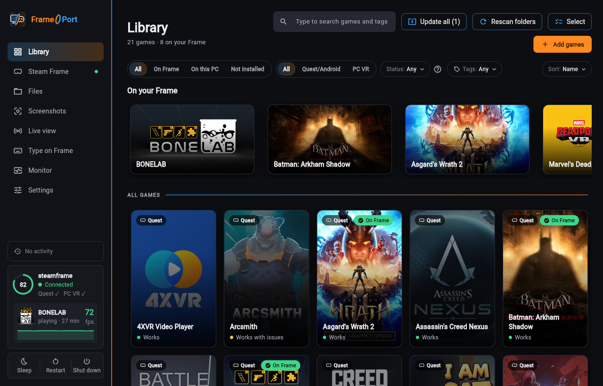
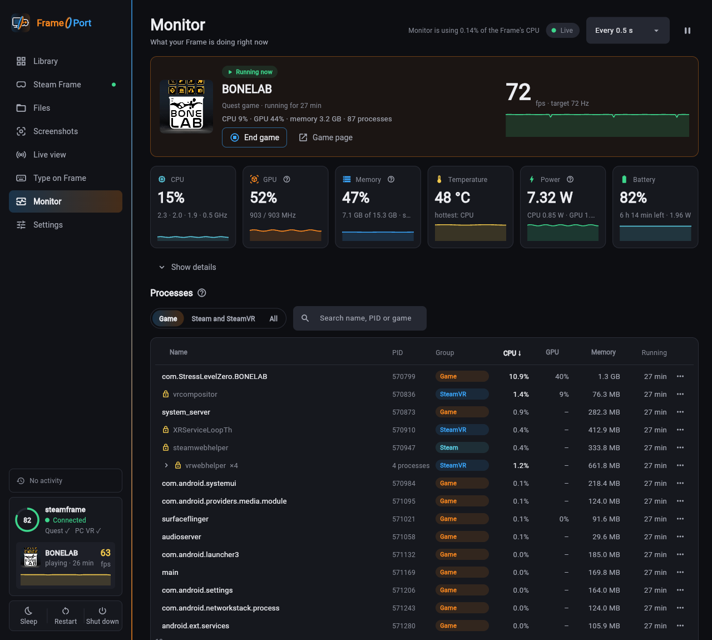
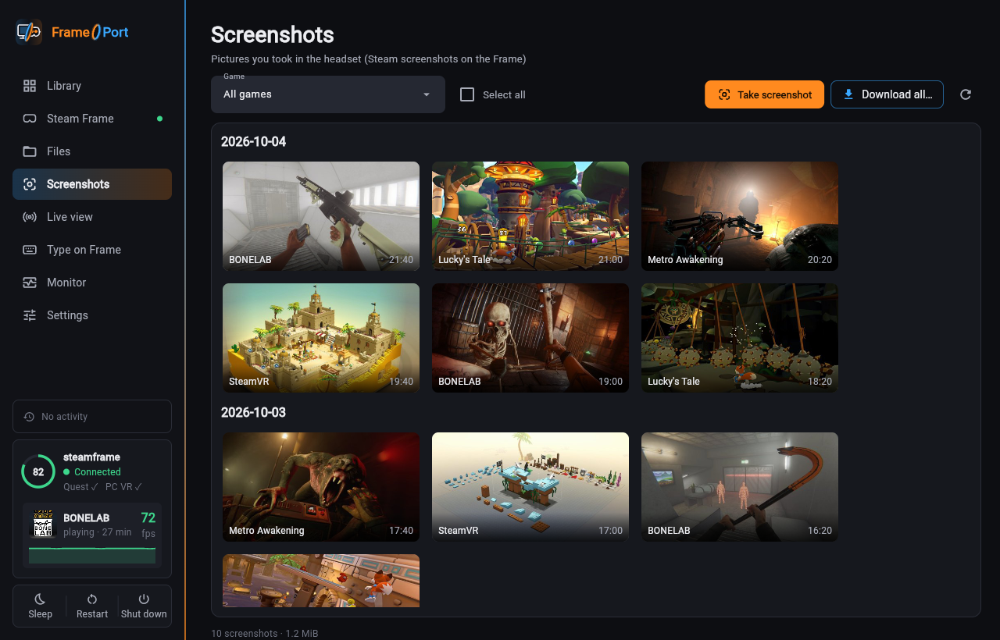

# FramePort

[](https://github.com/spoopyghosty0/frameport/releases/latest)
[](https://github.com/spoopyghosty0/frameport/actions/workflows/build.yml)
[](https://github.com/spoopyghosty0/frameport/releases)
[](LICENSE)


Install Quest games, Android apps, Linux apps and PC VR games on the **Valve Steam Frame**. FramePort sets up the
Frame, patches each game to run there, uploads the game and adds the game to your Steam library with artwork.

[](docs/media/frameport-tour.mp4)

▶ [Watch the tour](docs/media/frameport-tour.mp4) · [Watch the install tutorial](docs/media/frameport-install.mp4)
(about 90 seconds each)

> **Notice:** FramePort doesn't download, share or unlock games. Use games you got legally, for example from
> [SideQuest](https://sidequestvr.com/). FramePort downloads published open-source tools ([Built on](#built-on))
> and adds its own patches.
>
> Not every game runs on the Frame. Some need Meta's services or hardware the Frame lacks.

## Features



- **Easy setup:** one line in the Frame's terminal. No root, no password. [What it changes](docs/FRAME_SETUP.md).
- **One click per game:** patch, upload, add to Steam with artwork, test that the game starts.
- **Recipes:** tested patches and settings for hundreds of games. Other games get suggested patches, each explained.
- **Game settings:** sharpness, refresh rate, controllers, 360° video and mixed reality as simple switches.
- **More than Quest games:** Android apps in a window, Linux apps, PC VR games and Windows programs.
- **Install links:** "Install with FramePort" buttons on websites open in FramePort.
- **Your Frame from your PC:** Type on Frame, Files, Screenshots, Live view (what the headset shows) and Monitor
  (frame rate, temperatures, battery, processes).
- **Your room for mixed reality (experimental):** scan your room in the headset and fix the scan up in 3D. Try the room with
  [Test Quest MR](https://github.com/spoopyghosty0/TestQuestMR).
- **Updates itself**, and reports problems without personal data.






## Quick start

1. [Download](https://github.com/spoopyghosty0/frameport/releases/latest) FramePort for Windows, macOS (Apple
   Silicon) or Linux, unpack the download and start FramePort.
2. Click **Steam Frame → Start setup**. The Frame and your PC must be on the same Wi-Fi (or use a USB cable).
3. On the Frame open **SteamVR dashboard → Launch a program → Desktop**, then **app menu → System → Konsole**, and
   run:

   ```
   curl -fsSL https://frameport.app/s | bash
   ```

4. Click **Allow** when FramePort shows the same 4-digit code as the Frame. Steam restarts once. If Steam asks to install
   **Lepton** (Valve's Android runtime), confirm.
5. **Add games → Scan a folder…**, open a game and click **Install on Frame**. Play the game from the Frame's Steam library.

Full guide: [Install and first steps](docs/INSTALL.md). Game folders: [FAQ](docs/FAQ.md).

## Compatibility

Tested games get their recipe (the patches and settings that work) automatically. Other games get suggested
patches. See the [tested games](docs/GAMES.md). Got a game working?
[Share its recipe](docs/INSTALL.md#share-a-recipe-or-report-a-problem).

## Compared with other tools

FrameDrop and Valve's own tools install an app as it is. FramePort also:

- is **free and open source** (GPL-3.0). FrameDrop is free (donationware), without published source.
- **converts and patches Quest games** that don't run as they are, with tested recipes for hundreds of games.
- runs on **Windows, macOS and Linux**. FrameDrop is for Windows.
- connects over **Wi-Fi or a USB cable**, without a **Pair new host** step.

<details>
<summary>All differences</summary>

| | **FramePort** | **FrameDrop** | **By hand with Valve's tools** |
|---|---|---|---|
| Cost and source code | Free, open source (GPL-3.0) | Free (donationware), source not published | Free, from Valve |
| Runs on | Windows, macOS, Linux | Windows | Depends on the tool |
| First connection | One line in the Frame's terminal; turns on Developer Mode itself. No password | Turn on Developer Mode, then **Pair new host** | Turn on Developer Mode and pair, or use Android's debug tool (adb) |
| Wireless or cable | Wi-Fi, the Frame's hotspot or a USB cable | Same Wi-Fi network | Wi-Fi, or adb |
| Quest games that don't run as they are | Converted and patched for the Frame | Installed as they are | Installed as they are |
| Knows which patches a game needs | Tested recipes for hundreds of games, updated without an app update | Not stated | No |
| In the Steam library | Yes, with artwork and tags | As a "Devkit Game" shortcut | As "Devkit Game: &lt;title&gt;"; not with adb |
| Android apps, Linux apps, Windows programs | All three; Proton is installed for you | All three; install Proton first | Yes; 2D Android apps need an extra file |
| PC VR games | On your PC; some also on the Frame | Not supported | Not supported |
| "Install with …" buttons on websites | Yes ([frameport.app](https://frameport.app) links) | Its own | No |
| A game doesn't start | A launch test reads the logs and suggests a patch | A log viewer | No help |
| Use the Frame from your PC | Live view, Monitor, Files, Screenshots, Type on Frame | Not stated | No |

</details>

Based on each tool's own pages, checked 2026-10-09:
[FrameDrop about](https://framedropvr.com/about) · [how-to](https://framedropvr.com/how-to) ·
[Valve: loading games on Steam Frame](https://partner.steamgames.com/doc/steamhardware/steamframe/loadgames).
Out of date? [Report the problem](https://github.com/spoopyghosty0/frameport/issues/new).

## Built on

Most of the work is done by these projects:
[OVRPort](https://github.com/Android-XR-Bridge/OVRPort) (Quest → OpenXR, originally
[ovrport/app](https://github.com/ovrport/app)) · Valve Lepton, Proton and SteamVR ·
[Revive](https://github.com/LibreVR/Revive) · Mesa (Zink) · [Khronos OpenXR SDK](https://github.com/KhronosGroup/OpenXR-SDK)
· Eclipse Temurin, Android apksigner and NDK · [Flet](https://flet.dev) · OculusDB and Steam store data.
What FramePort adds: [Architecture](docs/ARCHITECTURE.md).

## Documentation

| | |
|---|---|
| [Install and first steps](docs/INSTALL.md) | Install, connect, install games, update |
| [What the setup changes](docs/FRAME_SETUP.md) | Changes on the Frame, firewalls, undoing it |
| [FAQ](docs/FAQ.md) | Game folders and fixing problems |
| [Compatibility](docs/COMPATIBILITY.md) · [Tested games](docs/GAMES.md) | What runs, and how well |
| [Controller buttons](docs/CONTROLLERS.md) | Quest buttons on the Frame's controllers |
| [Themes](docs/THEMES.md) | Color themes and making your own |
| [Install button](docs/INSTALL_BUTTON.md) | An "Install with FramePort" button for your download page |
| [Diagnostics](docs/DIAGNOSTICS.md) | What a problem report contains |
| [Patch reference](docs/PATCHES.md) | Every patch and game setting |
| [Porting playbook](docs/PLAYBOOK.md) · [Runtime reference](docs/FRAME_RUNTIME.md) | Symptoms and fixes; facts about the Frame |
| [Architecture](docs/ARCHITECTURE.md) · [Screenshots and videos](docs/SHOWCASE.md) | How the code and the docs' pictures are made |
| [Contributing](CONTRIBUTING.md) | Code, recipes, translations |

## Development

```
uv sync --extra dev
uv run frameport-gui        # the app
uv run frameport --help     # command line
uv run pytest               # tests
```

## AI usage

I don't have much free time for this project, so I use AI tools to debug compatibility problems faster.

## License

GPL-3.0-only (includes GPL-3.0 code from OVRPort). Not affiliated with Valve or Meta.
