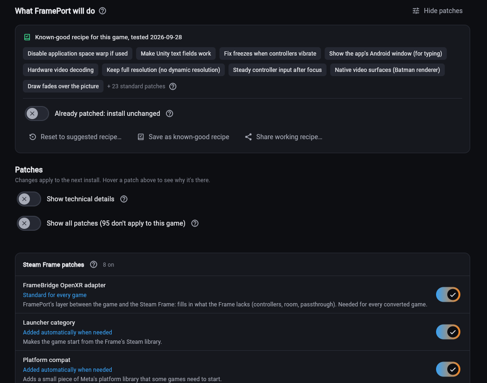
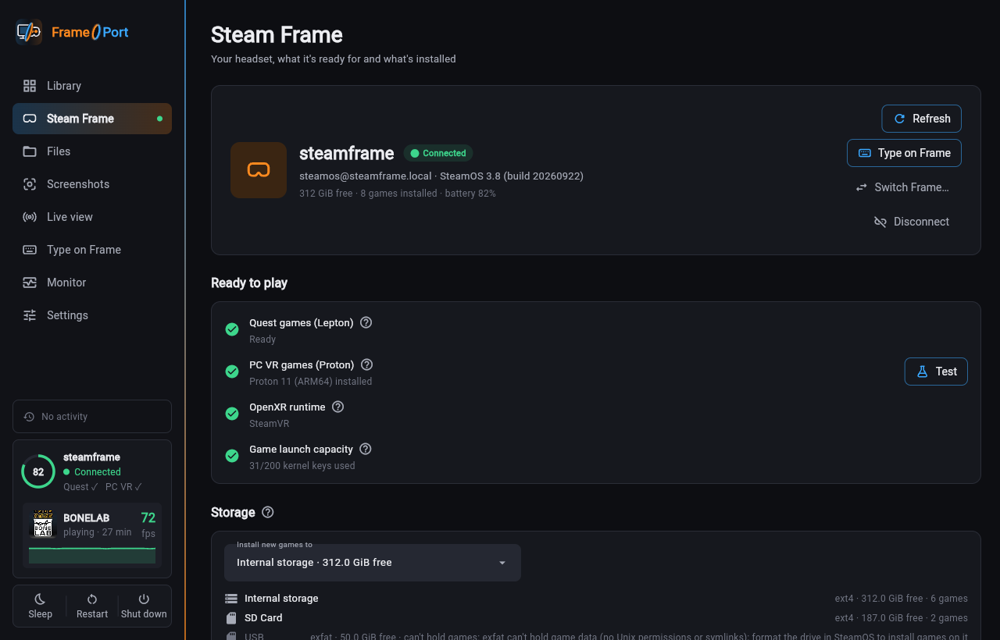

# Compatibility

FramePort has tested recipes (the patches and settings that work) for hundreds of games, each marked as working,
working with issues or not running: see the [tested games](GAMES.md). Other games get suggested patches, each with
its reason. **Customize** on a game's page turns any patch on or off.

Got a game working? [Share its recipe](INSTALL.md#share-a-recipe-or-report-a-problem).

| Kind of game | On the Steam Frame |
|---|---|
| Quest games | Converted to OpenXR (the Frame's VR standard) by OVRPort, patched, and run in Lepton, Valve's Android runtime |
| 32-bit Gear VR, Oculus Go and early Quest games | Run through FramePort's 32-bit bridge (experimental). The right controller acts as the Gear VR or Go controller |
| Other Android VR apps using OpenXR (for example Pico builds) | Converted the same way, without the other headset's own features and store services |
| Android apps without VR | Installed unchanged and shown as a window |
| PC VR games | On the Frame through Proton (experimental), or on your PC and streamed: see [PC VR games](INSTALL.md#pc-vr-games) |
| Linux apps | Installed unchanged. x86_64 builds run through FEX, slower than arm64 builds: see [Linux apps](INSTALL.md#linux-apps) |
| Can't run | x86-only Android apps, apps for Pico's or HTC's own VR system, Android XR apps, and games that check their license through the Oculus app |

Launch tests show that a game starts. Only the headset shows whether it looks right.

