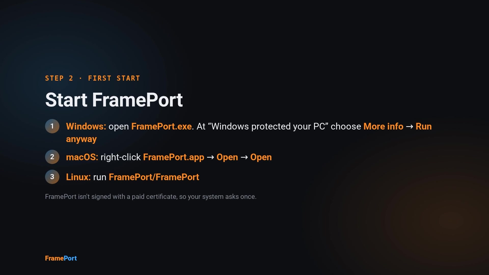
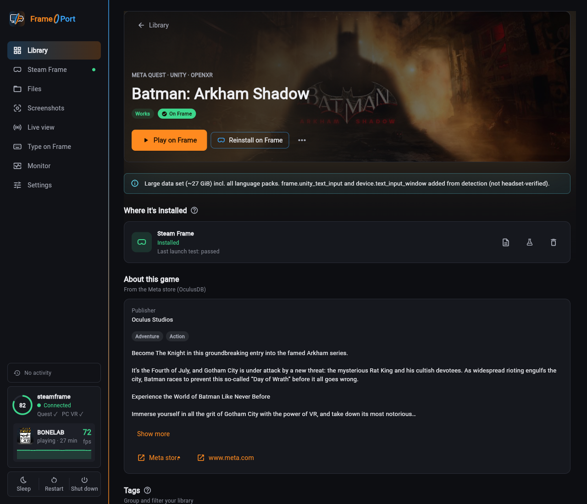
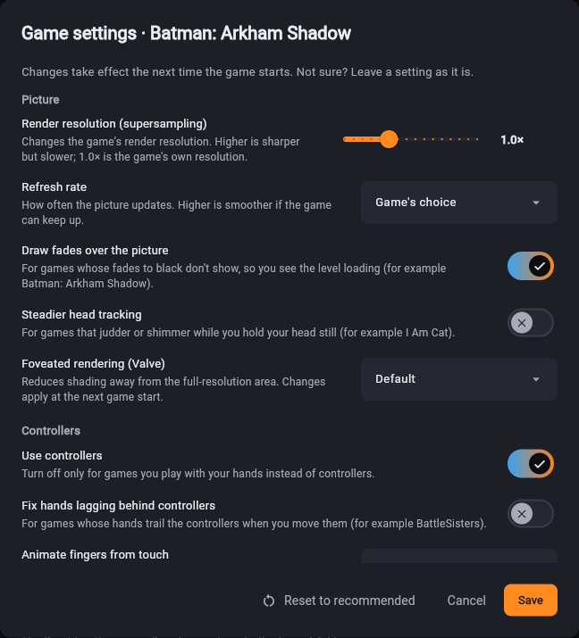
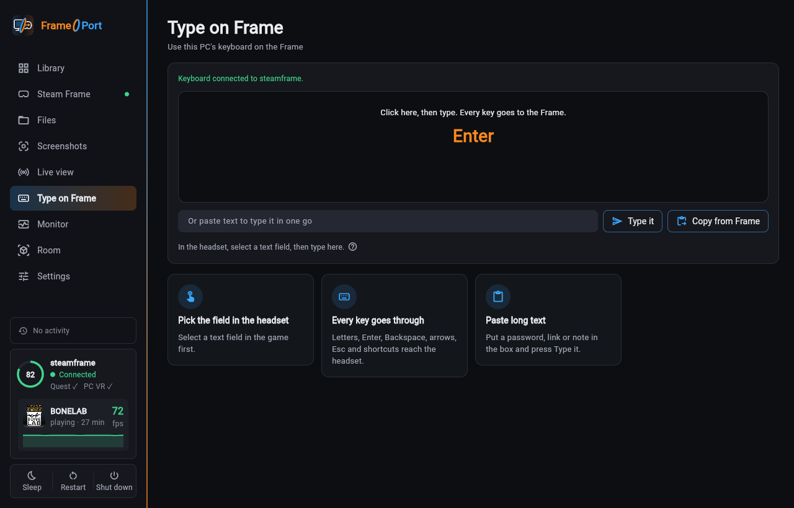
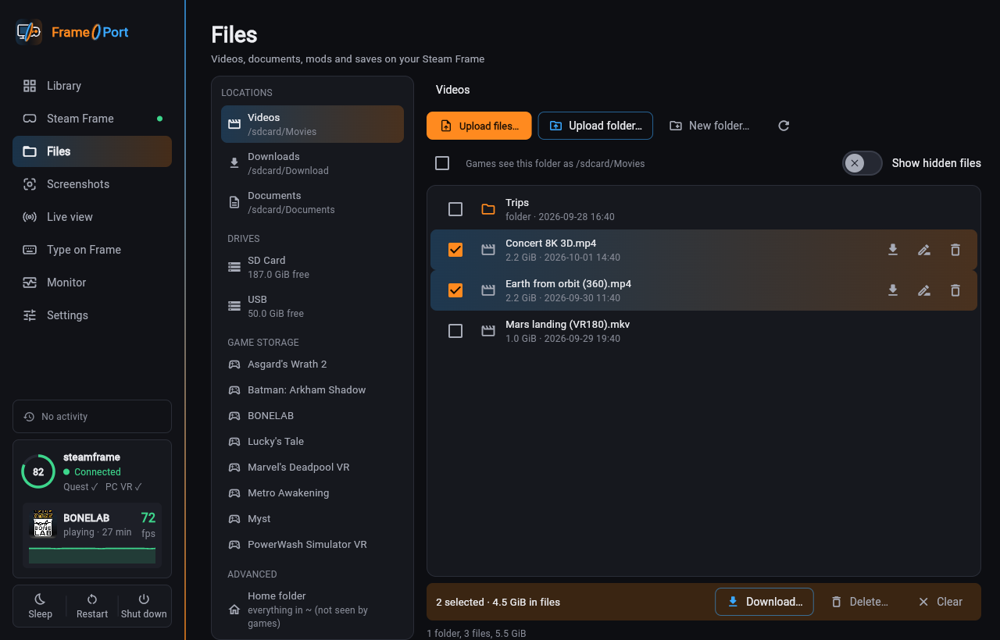

# Install and first steps

▶ **[Watch the install tutorial](media/frameport-install.mp4)** (about 90 seconds): from the download to the first
game on the Steam Frame.

[](media/frameport-install.mp4)

Download the file for your PC from the [latest release](https://github.com/spoopyghosty0/frameport/releases/latest)
and unpack it anywhere. No installer or admin rights needed.

| Your PC | Download | Start |
|---|---|---|
| Windows 10/11 (x64) | `FramePort-windows-x64.zip` | `FramePort.exe` |
| macOS (Apple Silicon) | `FramePort-macos-arm64.zip` | `FramePort.app` |
| Linux (x64, Ubuntu 22.04 or newer) | `FramePort-linux-x64.tar.gz` | `FramePort/FramePort` |
| Linux (ARM64, Ubuntu 22.04 or newer) | `FramePort-linux-arm64.tar.gz` | `FramePort/FramePort` |
| Arch Linux (AUR, community package) | [`frameport-bin`](https://aur.archlinux.org/packages/frameport-bin) | `frameport` |

On first start FramePort downloads the tools it uses (listed in Settings → Tools).

## First launch

FramePort isn't signed with a paid certificate, so the first start shows a warning:

- **Windows:** "Windows protected your PC" → **More info** → **Run anyway**.
- **macOS:** right-click `FramePort.app` → **Open** → **Open** (once).
- **Linux:** `tar xzf FramePort-linux-x64.tar.gz && ./FramePort/FramePort`. Arch Linux: `yay -S frameport-bin`.

## Connecting the Steam Frame

The Frame and your PC must be on the same network, or connected with a [USB cable](#with-a-usb-cable).

1. In FramePort open **Steam Frame** and click **Start setup**. Keep that page open.
2. On the Frame (first time only):
   1. Open **SteamVR dashboard → Launch a program → Desktop**.
   2. Open the app menu (bottom left) → **System → Konsole**.
   3. Type this line and press **Enter**:

      ```
      curl -fsSL https://frameport.app/s | bash
      ```

      No keyboard? Open [the setup page](https://frameport.app/setup/) in Chromium on the Frame, tap **Copy** and
      paste it into Konsole.
   4. Konsole shows a 4-digit code. When FramePort shows the same code, click **Allow**. Nothing changes before that.
   5. Steam restarts once. If it asks to install **Lepton** (Valve's Android runtime), confirm.

FramePort connects within a minute, without a password, and from then on by itself. The setup turns on **Developer
Mode** (Settings → System on the Frame); keep it on. [What the setup changes](FRAME_SETUP.md) lists everything.

- **Network blocks the search?** Click **Use the setup command** and run the line it shows in Konsole instead (it
  holds your PC's address and a one-time code).
- **Without Konsole:** turn on Developer Mode, then open Settings → Developer → **Pair new host** on the Frame.
  Approve FramePort's request in the headset. Install Lepton from FramePort's Steam Frame page if it's missing.

### With a USB cable

A cable works on networks that block the setup, and uploads are about three times faster than on typical Wi-Fi.

1. On the Frame, turn on Developer Mode (Settings → System). The cable only works in Developer Mode.
2. Connect the Frame's USB-C port to your PC. No driver needed.
3. Click **Steam Frame → Set up with a USB cable** and follow the steps.

Uploads use the cable while it's plugged in. Unplug it any time.

### Firewalls

If the setup only says "timed out", a firewall on your PC blocks the Frame. After about 45 seconds the setup page
says which one. Details: [Network and firewalls](FRAME_SETUP.md#network-and-firewalls).

## Running FramePort on the Frame (experimental)

1. Turn on Developer Mode (Settings → System).
2. In Desktop Mode, download `FramePort-linux-arm64.tar.gz`, unpack it and start `FramePort/FramePort`.

Games appear in Steam once you close FramePort and return to Gaming Mode ([when games appear in
Steam](#when-games-appear-in-steam)).

**Moving from a PC:**

1. First copy the signing keys: the `<package>.keystore` files from `overport-workspace/signatures/` in FramePort's
   data folder (Windows: `%LOCALAPPDATA%\FramePort`) to
   `~/.local/share/frameport-app/overport-workspace/signatures/` on the Frame. Without them, updates can't install
   over your games and progress tied to a Meta account can look gone.
2. Put the original game files on the Frame and add that folder to the Library there. The PC's library doesn't
   carry over. Data files on the same drive as the installs take space only once.
3. Installed games keep working, and reinstalling them from the Frame keeps their saves. Don't manage a game from
   both the PC and the Frame unless both have the same keys.

## Installing games



- **Install on Frame** on a game's page, or select several games in the Library. Installs run in the background;
  **Activity** shows the current one.
- **Update all** updates every game whose build changed, for example after a FramePort update.
- If the Frame sleeps or drops off the network, installs wait and continue. The Frame stays awake while they run.
- Your own game files are never changed.
- In the downloaded app you can **drag files onto the Library**: games, Linux apps, Windows programs or folders.
- App bundles (`.xapk`, `.apks`, `.apkm`, `.apkx`, split APKs) are added like an APK:
  [FAQ](FAQ.md#can-i-add-xapk-apks-apkm-or-apkx-files-app-bundles).

A game's **menu** opens with a right-click in the Library or the **…** button on its page. Its groups are
**Update**, **On the Frame**, **Saves**, **Name and artwork**, **Recipe** and **Troubleshoot**.

- **Game settings…** shows the settings that matter for that game: sharpness, refresh rate, controllers, menus,
  360° video and mixed reality. Changes apply the next time the game starts.
- **Name and artwork → Rename…** renames the game in the Library and in Steam. Its Steam entry, artwork and saves
  stay.



### When games appear in Steam

Steam reads new games only when it starts. Settings → Installing → **Steam library** sets when that happens:

- **Now** (default): Steam restarts after an install. It waits while a game, Desktop Mode or FramePort on the Frame
  is open (up to 12 hours).
- **Later**: new games appear at Steam's next start, also after a reboot. **Restart Steam now** adds them at once
  (it closes Desktop Mode and FramePort on the Frame, and asks first if a game is running).
- **Off**: no new Steam entries; existing ones stay. FramePort's **Play** starts the game directly. Steam and SteamVR
  must be running, and Steam's overlay, controller setup and Exit game don't work for it: end it from **Monitor**.
  Games waiting for **Later** start this way too.

Command line: `frameport frame steam-library now|later|off`, `frameport frame restart-steam [--yes]`. Installing
Proton can still restart Steam.

### microSD cards and other drives

- **Steam Frame → Storage → Install new games to** sets where new games go.
- **On the Frame → Move to…** in a game's menu moves it. Close the game first; saves and the Steam entry stay.
- A game on a card only starts while the card is inserted.
- Cards formatted as FAT, exFAT or NTFS can't hold games. Format the card in SteamOS first.

### Controller buttons

Buttons repeat or do the wrong thing? **Game settings → Controllers → Controller buttons** picks **Mirror** or
**Quest pair** for one game. **Settings → Controllers** sets the default; **Apply to installed games now** sends it
to games without their own choice. Details: [Controller buttons](CONTROLLERS.md).

### Android apps and Windows programs

- Android apps without VR are installed unchanged and shown as a window. Shows nothing, or a VR app opens as a
  window? On the game's page: **Customize** → **Show as VR or as a flat window** → **Update on Frame**.
- **Add games → Add a Windows program…** adds one Windows program. The Frame runs it as a window through Proton.

### Install links ("Install with FramePort" buttons)

Some websites have an **Install with FramePort** button (a `https://frameport.app/install?…` link).

- **Click it** (Windows, Linux): FramePort opens, shows what it would download and asks first.
- **Add games → Add from a link…** takes a button's address (right-click → Copy link) or a direct download link.
  Use this on macOS, where buttons can't open FramePort yet.
- **Settings → Install links** turns the buttons on or off.
- Only `https://` links to public servers work. Only install from sites you trust.

Website owners: [Install button](INSTALL_BUTTON.md).

## Typing on the Frame

- **Type on Frame** (sidebar): while the tab is open, your PC's keyboard types on the Frame. Select a text field in
  the headset and type, or paste text into the box.
- **Steam's on-screen keyboard** works in apps shown as a window. Steam lists that window as **Gamescope**: leave it
  open.
- **Unity text fields close at once?** Use the patch **Make Unity text fields work**. Not offered for an older game?
  **Troubleshoot → Analyze again**, then **Update on Frame**.



## Watching the Frame

- **Monitor** (sidebar): the running game's frame rate, CPU, graphics, memory, temperature, power and battery.
  **Show details** shows more.
- Under **Processes**, right-click a process to end it. **End game** closes the game like Steam's Exit game.
  FramePort asks again before ending programs Steam or the desktop needs (marked with a lock).
- **Live view** streams what the headset shows, with sound, to your browser. It uses about one CPU core of the
  Frame: stop it when you're done.
- **Screenshots** shows your headset screenshots by game and day, to view or download.

## Your room (mixed reality, experimental)

Mixed-reality games ask for your room: walls, furniture and surfaces. The **Room** tab keeps it.

1. **Scan room in the headset**, put the headset on and look around for about a minute. **Cancel scan** keeps your
   saved room. **Use my play area** makes walls only, from the SteamVR play area.
2. Check the room in 3D: drag to turn, scroll to zoom, right-drag to move, double-click to see all of it. **Open full
   3D view** shows every detail in your browser.
3. Fix it if needed:
   - **Clean-up** tidies every scan. The recommended settings suit most rooms; **Apply** re-cleans your scan with
     changed ones (also used for later scans).
   - **Labels** shows what each scanned box became and why. A tall, thin box by a wall can be **Add as door** or
     **Add as closet**.
   - **Furniture & screens**: click a box to change its type, place or size; add or delete boxes; add doors and
     windows. **Save** sends them to the Frame. They survive a new clean-up (**Back to the scan's boxes** drops them).

The free **Test Quest MR** app (**Get Test Quest MR** on the tab) shows what a game receives.


## Updating

FramePort checks for a new version at start and every 6 hours. **Update now** in the Library downloads it, checks
it and restarts; your games and settings stay. **Later** skips that version.

- Settings → **Updates** turns the check off or on, or turns on **Install updates automatically**.
- **Recipes** update by themselves. A game whose recipe changed shows **Update on Frame**.
- **Moved your games?** Scan the new folder or click **Rescan folders**. Moved games keep their name, artwork, tags
  and settings. [FAQ](FAQ.md#i-moved-my-games-to-another-folder-or-drive-how-do-i-update-the-library).
- **A newer version of a game:** game menu → **Update** → **Update with a newer APK…** (Quest and Android games) or
  **Update with a newer version…** (Linux apps, PC VR games). Then **Update on Frame** (or **on this PC**). Name,
  artwork, tags and settings stay.
- **Dev builds** (when asked to test a change): Settings → Updates → **Install the latest dev build…**.
- **AUR install:** update with your AUR helper (`yay -Syu`). FramePort can't update itself in `/opt`.

## PC VR games

Scan a folder of Windows VR games (one folder per game), or **Add games → Add a PC game folder…**. If a game has
several programs, FramePort asks which one starts it.

- **Play from this PC** (Windows with Steam and SteamVR): **Install on this PC** adds it to Steam. Stream it to the
  Frame with Steam Link.
- **Play on the Frame (experimental):** install *PC VR games (Proton)* on the Steam Frame page, then **Install on
  Frame**.
- **Oculus games** (made for Meta's Rift) need Revive, which FramePort downloads, and run only on your PC. Games that
  check their license through the Oculus app need the Oculus app there.

**Windows games without VR:** also **Add a PC game folder…**. The Frame runs them as a window through Proton.

## Linux apps

**Add games → Add a Linux app…** takes an AppImage or a `.zip`/`.tar.gz`/`.tar.xz` archive; **Add a Linux app
folder…** takes an unpacked app. **Install on Frame** uploads it unchanged and adds it to Steam.

- **arm64** builds run directly. **x86_64** builds run through FEX, which Steam installs the first time; they're
  slower. The game page shows which you have.
- Missing libraries are listed on the game page: look for a build that includes them.
- Linux apps also appear in Desktop Mode's app menu (switch **Desktop Mode** on the game page).
- **SteamVR overlay apps** (a wrist watch, a performance display) show over any game. They start with SteamVR
  (**Start with SteamVR** on the game page). Windows overlay apps use the patch **SteamVR overlay app (Frame)**.

## Files on the Frame

The **Files** tab copies files between your PC and the Frame: videos, documents, mods and saves.



- **Upload files**, **Upload folder**, **New folder**; right-click to download, rename or delete. Drag across
  entries to select several. In the downloaded app you can also drag files onto the list.
- **Videos**, **Downloads** and **Documents** are shared by every Quest game (`/sdcard/Movies`, `/sdcard/Download`,
  `/sdcard/Documents` inside the game).
- **Game storage** holds each game's own files (game menu → **On the Frame** → **Add videos and files**).

## Backing up saves

Steam doesn't sync Quest games' saves. **Back up saves** next to **Play** copies them to your PC (close the game
first); **Back up all saves** on the Steam Frame page does every game. Game menu → **Saves** → **Restore saves…** puts
one back. Settings → **Data** sets the folder, how many to keep and automatic backups.
[FAQ](FAQ.md#can-i-back-up-a-games-saves).

## Share a recipe or report a problem

- **Share working recipe…** (game menu → **Recipe**) opens a GitHub issue with the game's recipe filled in. Accepted
  recipes become built-in for everyone.
- **Report a problem…** (game menu → **Troubleshoot**, or Settings → Problems and feedback) saves a diagnostics zip
  without personal data and opens a GitHub issue to attach it to.

Without the app: [share a recipe](https://github.com/spoopyghosty0/frameport/issues/new?template=working-config.yml)
· [report a problem](https://github.com/spoopyghosty0/frameport/issues/new?template=bug-report.yml).

## Uninstalling

Settings → **Uninstall FramePort…** removes FramePort's data and, if you choose, its games on the Frame (saves can be
kept). It first saves your signing keys to Documents; you need them to update your games later. Then delete the
FramePort folder.

## Verify a download

- `sha256sum -c SHA256SUMS.txt` checks the files against the release's checksums.
- `gh attestation verify FramePort-windows-x64.zip -R spoopyghosty0/frameport` checks that GitHub built the file from
  this repository.
- Windows: to show FramePort as the publisher, import `FramePort-selfsigned.cer` (attached to each release) into
  *Trusted Root Certification Authorities* (Current User). It can only sign code; remove it with `certmgr.msc`.
  SHA-256 fingerprint:
  `4E:12:98:91:62:C0:E4:50:FB:65:1D:34:BB:73:00:09:7B:78:BE:88:5C:A7:6C:42:23:46:9B:92:A1:59:A7:6E`.

## Command line

The command-line version (Python 3.11 or newer) installs from the release's `frameport-<version>-py3-none-any.whl`
with `uv tool install <link>` (or pipx or pip). `frameport --help` and `frameport <command> --help` list every
option. The main commands:

| Command | What it does |
|---|---|
| `scan <folder>` / `list` / `show <game>` | add games, list the library, show a game's patches |
| `rename <game> "<name>"` | rename a game (`--reset`: back to the automatic name) |
| `folders [--add <folder>] [--remove <folder>]` / `rescan` | manage library folders; scan them again |
| `add-linux <path> [--exe <program>]` | add a Linux app (AppImage, folder or archive) |
| `new-version <game> <path>` | point a game at its newer version |
| `recipe <game> --enable/--disable <patch>` | change a game's patches (`patches` lists them) |
| `build <game>` / `install <game>` / `test <game>` | build, install on the Frame (`--to pc`: this PC), launch test |
| `session <game>` / `settings <game> <key>=<value>` | check the last play session; change a game setting without rebuilding |
| `frame discover` / `frame connect` / `frame info` | find, connect to and describe the Frame |
| `frame send <files> --dest videos` / `frame storage` / `frame cleanup` | copy files to the Frame, list targets, free space |
| `frame drives` / `frame move <game> --to <drive>` / `install --dest <drive>` | list drives, move a game, install to a drive |
| `saves backup <game>\|--all` / `saves list` / `saves restore` / `saves undo` | back up and restore Quest games' saves |
| `tools status` / `tools install` | the tools FramePort downloads |
| `open-link "<link>"` | install from an install link (`--yes`, `--no-install`) |
| `diag report <game>` / `share-recipe <game>` | report a problem / share a working recipe |
| `update` | update FramePort (`--check`: exit code 10 = update available) |
| `uninstall-app` | uninstall FramePort |

Exit codes: 0 done, 1 failed, 2 wrong usage. `FRAMEPORT_DEBUG=1` shows full errors; `FRAMEPORT_NO_UPDATE_CHECK=1`
turns update checks off.
