# Install button

A button for web pages and READMEs that opens a game in FramePort. FramePort shows what it would download and asks
before doing anything ([Install links](INSTALL.md#install-links-install-with-frameport-buttons)).

<p>
  
</p>

## Files

All files are in [`docs/badges/`](badges/). Each SVG is self-contained (no external fonts or images), 216 × 60.

| File | Use for |
|---|---|
| [`install-with-frameport.svg`](badges/install-with-frameport.svg) | Everywhere. No motion. |
| [`install-with-frameport-animated.svg`](badges/install-with-frameport-animated.svg) | GitHub READMEs and other image-only pages. Glows every 6 seconds. |
| [`install-with-frameport-hover.svg`](badges/install-with-frameport-hover.svg) | Websites where you can paste HTML. Glows under the pointer, only when the SVG code is in the page ([below](#on-a-website)). |
| [`install-with-frameport@2x.png`](badges/install-with-frameport@2x.png) | Places without SVG (some forums, email). 432 × 120; show the PNG at 216 × 60. |

The animated versions stand still for visitors who turn on reduced motion.

## The link

The button links to FramePort's install page with a manifest or one file:

```
https://frameport.app/install?manifest=<URL-encoded https address of a manifest .json>
https://frameport.app/install?url=<URL-encoded https address of an .apk, a Linux build (.zip, .tar.*, .AppImage) or a Windows .exe>
```

The page shows what the link installs, opens FramePort, and offers the download when FramePort isn't installed. For
people who already have FramePort you can link to the `frameport://` form directly:

```
frameport://install?manifest=<URL-encoded https address of a manifest .json>
frameport://install?url=<URL-encoded https address of an .apk, a Linux build (.zip, .tar.*, .AppImage) or a Windows .exe>
```

The manifest:

```json
{
  "schema": "framedrop.install/v1",
  "name": "My Game",
  "version": "1.4.2",
  "files": [{ "url": "https://example.com/my-game.apk", "sha256": "<64 hex digits>" }],
  "frameport": { "description": "One sentence about the game.", "icon": "https://example.com/icon.png" }
}
```

- `name` becomes the game's title in Steam.
- `sha256` is optional but recommended: FramePort checks the download against it.
- `frameport` is optional: the icon and description are shown in the install question.
- `version` is optional (`version` can also go inside `frameport`) and enables updates. FramePort fetches the manifest again
  at most every 6 hours and offers newer versions (Library bar, game page, `frameport link-updates [--install]`).
  Keep the manifest at the same address and raise `version` with every build. Versions compare number by number
  (`1.10` > `1.9`); a suffix sorts before the release (`1.2.0-beta2` < `1.2.0`). Bare file links (`?url=…`) and
  manifests without a version are never checked.
- Only public `https://` addresses are accepted.

To build a link from Python: `frameport.deeplink.make_link(manifest_url="https://…/my-game.json")`.

**Where to host the manifest.** The install page shows the manifest's name, description and icon only when the
manifest's host allows web pages to read the manifest (CORS); otherwise the page shows "A game or app". FramePort itself reads any public address.
On GitHub, commit the manifest and link the raw file
(`https://raw.githubusercontent.com/<owner>/<repo>/main/my-game.json`) or the file's `…/blob/main/my-game.json` page,
which FramePort turns into the raw address. A manifest attached to a GitHub release installs fine, but the page then shows the
release's name instead.

## On a website

Image version (any page):

```html
<a href="frameport://install?manifest=https%3A%2F%2Fexample.com%2Fmy-game.json">
  
</a>
```

Hover version: paste the contents of `install-with-frameport-hover.svg` inside the link instead of the ``, and
give the link an accessible name:

```html
<a href="frameport://install?manifest=https%3A%2F%2Fexample.com%2Fmy-game.json" aria-label="Install with FramePort">
  <svg …>…</svg>  <!-- the whole file -->
</a>
```

Host the files yourself, or load them from jsDelivr:
`https://cdn.jsdelivr.net/gh/spoopyghosty0/frameport@main/docs/badges/install-with-frameport.svg`. Replace `main`
with a release tag such as `v1.0.0` to pin a version (jsDelivr caches `@main` for up to 12 hours).

## In a GitHub README

GitHub removes `frameport://` links from READMEs. Use the `https://frameport.app/install?…` link with the animated or
still SVG (the hover version doesn't react on GitHub):

```markdown
[](https://frameport.app/install?manifest=https%3A%2F%2Fexample.com%2Fmy-game.json)
```

## Testing your setup

The example button on [frameport.app](https://frameport.app/#button) uses a demo link:

```
https://frameport.app/install/?manifest=https%3A%2F%2Fframeport.app%2Fdemo%2Fcool-game.json
```

Click the button to check that FramePort receives install links on your PC. FramePort shows a demo install question for "Cool Game";
nothing is downloaded or installed (`frameport open-link` says the link is the demo and stops).

## If a visitor doesn't have FramePort

The `https://frameport.app/install?…` link handles a missing FramePort: the install page offers the download. A bare `frameport://` link does
nothing visible without FramePort, so add a line such as "Needs [FramePort](https://frameport.app)". On macOS, web
pages can't hand links to FramePort yet: users paste the link into **Add games → Add from a link…**.

## Usage rules

- Keep the alt text "Install with FramePort".
- Don't recolor, stretch, crop or redraw the button, and don't show the button smaller than 40 px tall.
- Leave at least 8 px of space around the button.
- The button works on light and dark pages as it is; there is no light version.
